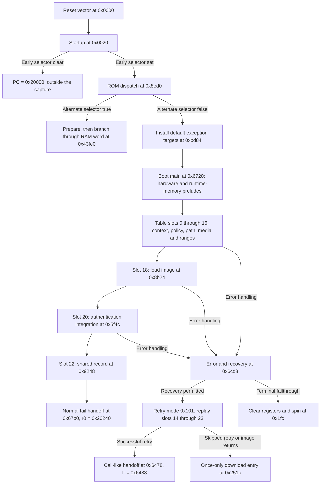

# MSM8930 revision 1.2: reset to loaded-image handoff

This first pass establishes the top-level paths and selected interfaces in
the [verified artifact](manifest.json). The [symbol map](symbols.json) holds
the machine-checkable byte anchors. Names are analyst-assigned; confidence
describes a static interpretation, not proof that this handset took a path.

The code inspected here is little-endian ARM state. An internal Thumb path
has not been established. `bx` can interwork, but its presence is not proof
that a particular target is Thumb code.

## Map at a glance



This is a summary, not an exhaustive CFG. Callbacks and early setup have
their own error paths. In particular, the error handler is not synonymous
with the final halt sink.

## 1. Reset and the two early selectors

The first eight words are ARM exception-vector branches. The reset vector
at `0x0` is `b 0x20`. Startup preserves incoming values using banked FIQ
registers, masks interrupts while switching modes, and performs MMIO setup.
Several referenced addresses fall in the clock-controller range, but that
does not establish the meaning of every register bit.

At `0xac–0xbc`, bit 0 read from `0x00706034` selects:

- clear: execute `mov pc,#0x20000`;
- set: continue ROM startup, including stack setup around `0x2e000`.

The register's semantics are unresolved. Do not call this bit
“secure boot enabled” or assert which path ran on the captured device.

Startup loads `0x8ed0` through the literal at `0x348` and executes `bx r0`
at `0x188`. There, helper `0x8890` tests bit `0x100` at `0x0020002c`, then
bit `0x80` on a second read if necessary. A true result calls `0xc1d4`
and branches through the RAM word at `0x43fe0`. Otherwise it calls
`0xbd84` and tail-branches to boot main at `0x6720`.

`0xbd84` only copies a `0x20`-byte default exception-pointer table from
ROM `0x124c0` to SRAM `0x43fe0`. It is not the full runtime initializer.
The helper at `0x268` transfers 32-byte blocks, then 4-byte words; the
zeroing helper at `0x2bc` uses similar granularity. These are not arbitrary
unaligned-byte `memcpy`/`memset` contracts.

## 2. Boot main and initialized working memory

Boot main calls the hardware prelude at `0x67d8`, then runtime initializer
`0x9328`. That initializer and helpers `0x9428`/`0x93dc` copy ROM templates
and clear working regions. One clear covers `[0x201e8,0x20358)`, including
the later shared record, boot context and image header.

Useful names for the rest of this document:

| Name | RAM address | Meaning established here |
|---|---|---|
| `C` | `0x202a8` | Boot context, explicitly cleared for `0x30` bytes |
| `S` | `0x20240` | Record passed to the loaded image |
| `H` | `0x202d8` | Retained `0x50`-byte image header |
| `A` | `0x20660` | Authentication-related context |
| `F` | `0x203bc` | Media/backend context and callbacks |

These addresses are referenced SRAM, **not bytes captured in `pbl.bin`**.
Initial templates do not tell us the eventual live contents after MMIO
reads or an alternate path.

### Ordered callbacks

The table at `0x10ce0` has **24 word slots**, not a null-terminated list.
The loop at `0x6738–0x6764` skips zero slots and visits all 24. There are
12 non-null entries; every odd slot is zero. Each callback receives `r0=C`.

| Word slot | Entry | Role in this pass |
|---:|---:|---|
| 0 | `0xbb80` | Clear/init context; default load base and PMIC-related defaults |
| 2 | `0x8208` | Write `1` to `0x00800820` and `0x104` to `0x008016c0`; purpose unresolved |
| 4 | `0x8800` | Select/configure a clock-related profile |
| 6 | `0x61bc` | Initialize cached authentication policy/context |
| 8 | `0x8d38` | Gated PMIC-associated setup |
| 10 | `0x7ea0` | Consume/clear a matching three-word boot-path cookie |
| 12 | `0x8594` | Select the boot-path code |
| 14 | `0x6ef8` | Select and initialize a media backend |
| 16 | `0xbce0` | Once-only registration of allowed load intervals |
| 18 | `0x8b24` | Read/validate header, load payload, retain entry/auth inputs |
| 20 | `0x5f4c` | Authentication integration, conditional on cached policy |
| 22 | `0x9248` | Construct and publish the shared handoff record |

The profile codes are `0x14` and `0x41` (20 and 65 decimal), **not proven
MHz values**. A callback result other than zero enters `0x6cd8`, reporting
the result and the **word-slot index**, not the ordinal non-null callback.

### Media-routing boundary

The media stage routes the selected path code as follows:

| Codes | Callee | Present interpretation |
|---|---:|---|
| `1–4`, `14`, `15`, `0x101` | `0x7514` | SDCC-associated backend |
| `5`, `9`, `16` | `0x7aac` | SPI-associated backend |
| `13` | `0x81c0` | Download-associated path |
| `0x100` | `0x7514`, then possibly `0x81c0` | Storage first, download fallback |

Decimal codes are written without `0x`. The SDCC/SPI/download names are
supported by their code and filename references, not complete driver
reconstructions. A media backend must report status `3`; after interface
checks the outer stage returns boot-stage success `0`. The download wrapper
calls `0x362c(2)` and reports `4` if that call returns.

## 3. Image loading is separate from authentication

`load_selected_image` at `0x8b24` calls the header wrapper at `0x719c`,
which dispatches through `F+0x1c`. The SDCC header adapter requests
`0x50` bytes. Header-location discovery and the origin/units of media
offsets remain part of the later storage pass.

The fields used by this loader and its immediate auth integration are:

| Header offset | Observed use |
|---|---|
| `+0x04` | Required magic `0x73d71034` |
| `+0x14` | Payload source field passed to the media read; must be nonzero |
| `+0x18` | Destination; `0xffffffff` selects `C+0x08` instead |
| `+0x1c` | Complete payload length; must be nonzero |
| `+0x20` | Code length; must be nonzero |
| `+0x24/+0x28` | Signature address/length |
| `+0x2c/+0x30` | Certificate-chain address/length |
| `+0x34/+0x38` | Conditionally consumed extended-root policy inputs; exact types unresolved |

Unused words are not assigned guessed vendor field names. The loader
compares total length with the 4-byte-aligned sum of code, signature and
certificate lengths. It resolves the destination, calls range checker
`0x64c4`, then passes this descriptor to `0x7160` / `F+0x18`:

```text
{ mode: 1, source: H[0x14], destination: resolved_destination,
  length: H[0x1c] }
```

The default destination is `0x2a000000`. Registered inclusive byte ranges
include `[0x0002e000,0x00043e4f]` and `[0x2a000000,0x2a03ffff]`.
Do not confuse the latter endpoint with `C+0x0c=0x2a03fffc`, which is a
last-word address.

After a successful payload read, `0x62b0` stores code/header/signature/
certificate ranges at `A+0x18..0x34`. **This is only a parameter setter.**
The loader then sets `C+0x10=1` and `C+0x14=resolved_destination`.
It does not rewrite the original header destination on the default path.
Signature/certificate addresses are copied from the header, not recomputed
from the destination.

The separate stage at `0x5f4c` consults the cached policy. When enabled, it
calls certificate processing at `0xf840`, checks returned metadata, then
calls signed-image verification at `0xf284` with both header and code
ranges. Their full cryptographic contracts are not recovered here.

| Result path | Observed handling |
|---|---|
| Header-read failure, checked-magic mismatch, payload-read failure | Loader returns `4` |
| Required-field/size/range assertion | Nonreturning error/recovery handling |
| Successful load/setup | Loader returns `0` |
| Authentication disabled by cached policy | Auth stage returns `0` without those verification calls |
| Certificate processing failure | Auth status `7` |
| Certificate metadata class rejection | Auth status `0x12` |
| Signed-image verification failure | Auth status `8` |

This documents branch behavior, **not the phone's actual policy state**.
No fuse or cached-policy values were acquired in this analysis pass.

## 4. The shared-record and entry contracts

Relevant context fields:

| `C` offset | Recovered role |
|---|---|
| `+0x00` | Clock-related profile code |
| `+0x04` | Selected boot-path code |
| `+0x08/+0x0c` | Default load base / last-word address |
| `+0x10/+0x14` | Loaded flag / saved image destination-entry |
| `+0x18/+0x1c` | Media context / authentication context |
| `+0x20/+0x24` | PMIC-related raw/status values; defaults `0x7fffffff` / `8` |
| `+0x28/+0x2c` | Shared-record pointer / boot-cookie selector |

The last callback, `0x9248`, calls base-record initializer `0xbaac`, media
exporter `0x7a18`, auth exporter `0x6310`, header publisher `0x8ce8`, and
tail-enters `0x8f04` for the PMIC-related fields.

| `S` offset | Established content |
|---|---|
| `+0x00` | Constant `0x00020200`; interpreting it as a version is provisional |
| `+0x04` | ROM service-table pointer `0x10d40` |
| `+0x08` | Constant `0x2e000`, also used in startup stack setup |
| `+0x0c/+0x10` | Working-region base `0x201e8` and span `0x170` |
| `+0x14` | Profile code from `C+0x00` |
| `+0x18` | Hardware-derived word |
| `+0x1c/+0x20` | Zero-extended hardware-derived halfwords |
| `+0x24` | Exported media-descriptor pointer `0x201e8` |
| `+0x28..+0x3c` | Copies of `A+0x00..+0x14`: policy/blob/identity fields |
| `+0x40/+0x44/+0x48/+0x4c` | Copies of `A+0x38/+0x44/+0x3c/+0x40`; extended-policy fields |
| `+0x50` | ROM auth-related blob pointer `0x119a4` |
| `+0x54` | Retained image-header pointer `0x202d8` |
| `+0x58/+0x5c` | `C+0x20/+0x24`, not necessarily zero |
| `+0x60/+0x64` | Initially zero on the traced normal path; separate download export can populate them |

The five ROM service pointers are `0x8af4`, `0xf840`, `0xf284`, `0x251c`,
and `0x63b8`. Merely exporting a pointer does not recover its full call ABI.

Normal handoff at `0x67b0` uses a **pre-indexed writeback** load:

```text
ldr r1,[r4,#0x14]!   // r4 becomes C+0x14; r1 = saved entry
ldr r0,[r4,#0x14]    // now reads C+0x28, the shared-record pointer
pop {r4,r5,r6,lr}
bx r1
```

Thus the meaningful incoming argument is `r0=S=0x20240`, and the target is
the selected destination, not invariably the default. The boot-main frame
is restored. Other observed register leftovers are not declared extra ABI
arguments. The inspected handoff itself performs no additional explicit
cache/MMU or privilege-mode transition.

An independently inspected, matching-device SBL1 preserves incoming `r0`
and copies **`0x68` bytes** from it to `0x2a016878`. That corroborates the
shared-record extent; it is not merely a guessed `sizeof` from the normal
publisher's last store at `+0x5c`. SBL1 is not included in this repository;
its identity and the supporting instruction windows are retained in the
analysis evidence note.

## 5. Recovery is not the same handoff

Before terminal halt, `0x6cd8` may call `0x63b8` when a hardware-derived
gate permits recovery. Recovery may:

1. Skip retry if already attempted, or if the current path is `13`/`0x101`.
2. Reinitialize part of runtime/auth state and select mode `0x101`.
3. Replay word slots **14 through 23**: media, ranges, load, auth, shared data.
4. Validate loaded state and enter the selected image.

At `0x6478–0x6484`, recovery loads the same meaningful entry/shared pointer
but sets **`lr=0x6488` and keeps its 32-byte frame**. This is call-like,
unlike the normal restored-frame tail branch.

If retry is skipped or the image returns, a once-only fallback can enter
`0x251c`, which requests profile `0x14` then branches to `0x362c(2)`.
If recovery returns to the error handler, its terminal fallthrough reaches
`0x1fc`: clear general registers, then spin at `0x230`.

## What remains unknown

- Which selectors, cached policies and paths actually applied to this phone.
- Exact MMIO register meanings, clock-code units and PMIC field types.
- Full root/certificate/identity structures and cryptographic implementation.
- Exact media/header discovery, SD/eMMC commands, USB descriptors/endpoints,
  download framing and backend selection.
- Original vendor function names, and any uninspected ARM/Thumb transitions.
- Whether other ROM mappings/aliases exist; the zero suffix is not proof
  that this capture exhausts the SoC's immutable code.

Next independent passes should start at `0x7514`/the media callbacks for
SDCC, and `0x81c0 → 0x362c` for download/USB. This first pass does not require
hardware experiments or a replacement bootloader.
